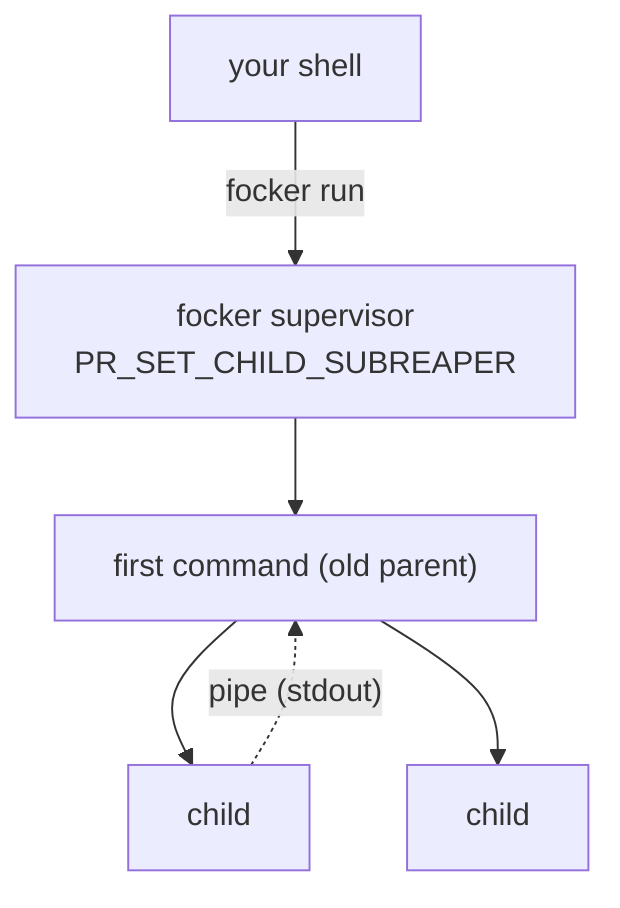

# focker architecture

## 1. The kernel facts focker is built on

1. **A process's parent is fixed at fork time.** `fork`/`clone` set `real_parent`. No syscall moves a live child to a different live parent. (`CLONE_PARENT` only picks the parent at creation time; `ptrace` attach makes you the *tracer*, but `getppid()` still returns the real parent.)
2. **The parent changes only when the parent dies.** In `exit_notify()` → `forget_original_parent()`, the kernel walks up from the dead parent to the nearest ancestor with `PR_SET_CHILD_SUBREAPER` set, or else to the PID namespace's init, and makes that the new `real_parent` of every child. This happens while the old parent is still a zombie, so it's visible in `/proc/PID/status` (`PPid:`) right away.
3. **`execve()` keeps the PID, the children and the subreaper flag.** A process can become a different program without its children noticing anything.
4. **`pidfd_getfd()` (5.6+) copies an fd out of another process**, subject to a ptrace-attach permission check. Under Yama `ptrace_scope=1`, an ancestor passes that check.
5. **A ptrace-stopped task doesn't take signals until it is resumed**, and when it is resumed under trace, every signal goes through a signal-delivery-stop where the tracer can drop it.

From 1 and 2: to give a child a new parent, the new parent must be an ancestor subreaper and the old parent must exit. From 3: the "new parent" can be any program, as long as it is exec'd *into* that ancestor. From 4 and 5: the old parent's exit can be made invisible to the child.

## 2. Components

```
                 ┌───────────────────── focker CLI (main.c, client.c) ─────────────────────┐
                 │ parse args → validate → NUL-token request → print reply → exit 0/1/2   │
                 └────────────────────────────────┬────────────────────────────────────────┘
                                                  │ unix socket  $FOCKER_RUNTIME_DIR/NAME/control.sock
┌─────────────────────────────── supervisor (supervisor.c) ──────────────────────────────────┐
│ PR_SET_CHILD_SUBREAPER · signalfd(CHLD,TERM,INT,HUP,QUIT) · poll loop                      │
│   ├─ reaper: waitid(WNOWAIT) peek → name → waitpid → member table                          │
│   ├─ drains: held read ends → adopted-PID-fdN.log                                          │
│   ├─ requests: info · members · inspect · stop · cutover ─→ cutover.c · handover (execve)  │
│   ├─ cutover in flight: stepped every 20 ms round; others get busy, reads still answered   │
│   └─ exit when no children remain (unless --linger)                                        │
└────────────────────────────────────────────────────────────────────────────────────────────┘
      cutover.c   freeze (ptrace|signal) · fd plan + pidfd_getfd · pidfd_send_signal · verify · thaw/swallow
      procfs.c    ppid, state, cmdline, children, threads, fds (+fdinfo access mode), pending signals
      unixdiag.c  NETLINK_SOCK_DIAG dump: unix socket inode → peer inode
      inetdiag.c  NETLINK_SOCK_DIAG dump: loopback TCP socket inode → peer inode
      util.c      sbuf, logging, runtime dir, signal names, pidfd syscall wrappers
```

| file | lines | responsibility |
|---|---|---|
| `src/main.c` | 569 | argument parsing, help text, `run` (including detaching) |
| `src/client.c` | 381 | control-socket client, `ps`, `tree`, `logs`, `rm`, `freeze`/`thaw` |
| `src/supervisor.c` | 642 | subreaper loop, member table, drains, request dispatch, handover |
| `src/cutover.c` | 699 | the cutover state machine |
| `src/procfs.c` | 318 | `/proc` readers |
| `src/unixdiag.c` | 100 | unix socket peer lookup |
| `src/inetdiag.c` | 190 | loopback TCP peer lookup |
| `src/util.c` | 203 | shared helpers |

## 3. Process layout



In detached mode (`-d`), the CLI forks. The child calls `setsid()` and becomes the supervisor, with stdio sent to `focker.log`. The parent waits for a "ready" byte on a pipe and exits. The first command is placed in its own process group (`setpgid(0,0)`). Its parent is then in the same session but a different group, so its group is never an *orphaned process group*. That matters, because the kernel sends `SIGHUP`+`SIGCONT` to stopped members of a newly orphaned group (see §5.2).

## 4. The cutover state machine

```mermaid
stateDiagram-v2
  [*] --> Validate
  Validate --> Plan: pinned by pidfd; descendants, not focker, not each other's parents
  Plan --> [*]: --dry-run
  Plan --> Freeze
  Freeze --> TakeFds: every thread stopped
  Freeze --> Rollback: freeze failed
  TakeFds --> CutTies: pidfd_getfd each linked fd
  CutTies --> WaitReparent: pidfd_send_signal(old parent) or --wait
  WaitReparent --> Verify: every target's PPid != old parent
  WaitReparent --> Rollback: timeout
  Verify --> Thaw: record members (adopted / died / went elsewhere)
  Thaw --> Report: swallow fresh signals, detach
  Report --> [*]
  Rollback --> [*]: close taken fds, thaw, exit 1
```



### 4.1 Validate and plan

- Targets are the named PIDs plus the children of `--from`. Each is pinned with `pidfd_open` *before* anything reads its `/proc` entries, and must be a strict descendant of the supervisor (walk `PPid:` up). Direct children are skipped.
- Right before and right after each freeze, `pidfd_send_signal(fd, 0)` must still succeed and the process must not be a zombie. Otherwise the validated process is gone and its PID could already belong to someone else, so the cutover rolls back with `N exited before it could be frozen`.
- Old parents are read from `PPid:`. Bystanders are the old parents' other children.
- **fd plan:** for each target T with old parent P, compare `/proc/P/fd` and `/proc/T/fd`:
  - **pipes:** the same `pipe:[ino]` with *opposite* access modes (from `/proc/PID/fdinfo/N` `flags:`). That is P's end of a pipe whose other end T holds. If both hold the same end, it's an inherited duplicate, and closing P's copy changes nothing, so it's skipped.
  - **unix sockets:** the two ends of a `socketpair()` have different inodes, so the inode alone doesn't tie them. `unixdiag.c` dumps `NETLINK_SOCK_DIAG` with `UDIAG_SHOW_PEER` and matches P's socket whose peer inode is one of T's sockets.
  - **loopback TCP:** when a socket has no unix peer, `inetdiag.c` is asked. It dumps established TCP sockets for AF_INET and AF_INET6 with `inet_diag_req_v2`, keeps those whose both ends are loopback (`127.0.0.0/8`, `::1`, `::ffff:127.0.0.0/104`), and pairs P's socket with T's when each one's local endpoint is the other's remote endpoint. Addresses are compared in IPv6 form, so a dual-stack socket pairs with a plain IPv4 one. Listening sockets and connections to other hosts are never dumped or never paired, so they are never taken. The kind is `tcp`, and it's drained like a unix socket.
  - Read ends (`pipe-r`) and sockets (`unix`, `tcp`) are *drained*. focker reads them into `adopted-T-fdN.log`, so a child writing to stdout never blocks on a full pipe. Write ends (`pipe-w`) are only held open, so the child never sees EOF on stdin.

### 4.2 Freeze

`--freeze ptrace` (default): for each thread in `/proc/T/task`, `PTRACE_SEIZE`, then `PTRACE_INTERRUPT`, then `waitpid(tid, __WALL)` until it is in a ptrace-stop. The thread list is re-read until it stops changing, which catches threads cloned mid-freeze. If a thread reports a signal-delivery-stop instead of the interrupt trap, it is still stopped, and the signal is saved to re-inject on detach. `SEIZE` (not `ATTACH`) sends no `SIGSTOP`, so neither the child nor its parent sees a job-control stop.

`--freeze signal`: `kill(SIGSTOP)`, then poll `State:` until it reads `T`. This is simple, but it's visible, and signals sent during the window are delivered on `SIGCONT`.

The pending-signal set (`ShdPnd` | every thread's `SigPnd`) is snapshotted *before* the freeze.

Every ptrace wait first peeks with `waitid(WNOWAIT)`. If the thread-group leader has exited and is already focker's child (adopted), its zombie is left alone, so the supervisor's reaper records its exit status, logs it and releases its held fds. Exits focker sees only as the tracer are reaped as before, because the real parent can't reap a traced zombie until the tracer has.

### 4.3 Take fds, cut ties, wait

`pidfd_open(P)`, then `pidfd_getfd(P, fd)` for each planned fd. The new fd is `O_CLOEXEC` and shares the open file description, so the pipe now has a second holder. Then `pidfd_send_signal(P, SIG)`, which can't hit a recycled PID. Then the wait: `cutover_start` returns a pending job, and the supervisor's loop calls `cutover_step` every round (the poll timeout drops from 1 s to 20 ms while a job is in flight). Each step re-reads every target's `PPid:` and ends the job once none of them points at P any more, or rolls back once `--timeout` has passed. Meanwhile the loop keeps draining held fds and answers `info`, `members` and `inspect`; `cutover`, `release`, `stop` and `handover` are refused with `busy (a cutover is in progress)`. A client that disconnects mid-wait doesn't stop the cutover; its reply is dropped.

### 4.4 Verify, thaw, swallow

For each target:
- If its parent is now the supervisor, it is adopted and recorded as a member with origin `a`.
- If it is gone or a zombie, it died during the cutover. In practice that means `PR_SET_PDEATHSIG=SIGKILL`, which cannot be intercepted.
- If it has some other parent, a subreaper sits between focker and the old parent.

**Swallowing**, with ptrace only: `fresh = pending_now & ~pending_before & ~{CHLD,CONT,WINCH,URG}`, minus the job-control stops (`STOP`, `TSTP`, `TTIN`, `TTOU`), which are reported as kept. If `fresh` is non-empty, every thread gets `PTRACE_CONT(0)`, and focker loops on non-blocking waits for up to 250 ms. Each signal-delivery-stop for a signal in `fresh` is continued with 0, which drops it. Any other signal is passed through. Then the threads are interrupted again and detached (`PTRACE_DETACH` needs a stopped tracee). A signal the process has blocked stays pending, and it is reported, not swallowed.

A group-stop seen in the loop (a kept `SIGSTOP`) is continued with `PTRACE_CONT`, not `PTRACE_LISTEN`. A listening tracee never dequeues the signals that still have to be swallowed, so they would be delivered on the next `SIGCONT`. `PTRACE_DETACH` re-arms a group-stop that is in effect, so the process ends up stopped either way.

Signals in `pending_now & pending_before` are reported as already pending. A standard signal doesn't queue, so a copy sent during the cutover merged into the pending one and can't be detected or swallowed.

What this catches:
- `PR_SET_PDEATHSIG` with any signal except `SIGKILL`. The kernel sends it to the child as part of the reparent.
- An old parent whose shutdown path does `kill(child, SIGTERM)`, `kill(0, ...)` or the shell `trap 'kill $!' TERM`.
- Anything else aimed at the child while it was frozen.

## 5. Things that only matter because of the details

### 5.1 Reaping without stealing names

The reaper calls `waitid(P_ALL, WEXITED|WNOHANG|WNOWAIT)` first. That only peeks, so the zombie still exists and an unregistered orphan's `/proc/PID/comm` can be read before `waitpid` reaps it. While a cutover is in flight, a peeked exit of one of its targets stops the reaper for that round: a frozen target is focker's tracee, so its exit reaches focker first. The job consumes it at its next step (`waitpid(__WALL|WNOHANG)` for every target whose pidfd says it's gone and that isn't a member), so a target that dies while frozen is never recorded as a member, and the reaper resumes within 20 ms.

### 5.2 Orphaned process groups and SIGSTOP

When a process exits, the kernel checks whether that makes a process group *orphaned*, meaning no member has a parent in a different group of the same session. If the group is now orphaned and has stopped members, every member gets `SIGHUP` then `SIGCONT`. Freezing with `SIGSTOP` and then killing the parent is exactly that setup. focker avoids it in two ways:
- the first command gets its own pgrp under a supervisor in the same session (detached mode)
- the default freeze is ptrace, and a ptrace-stop isn't a job-control stop, so `has_stopped_jobs()` ignores it.

### 5.3 Long runtime paths

`sun_path` is 108 bytes. If `DIR/control.sock` doesn't fit, both sides use `/proc/self/fd/N/control.sock`, where N is an `O_PATH` fd for the directory.

### 5.4 Signals to the supervisor

`signalfd` handles them. A signal with `ssi_code == SI_KERNEL` came from the tty, which already signalled the whole foreground group, so it isn't forwarded. `kill(1)`-style signals are forwarded to direct children. A TERM, INT, HUP or QUIT that arrives while a cutover is waiting cancels it first, whatever its source: the transcript says `cutover: cancelled by SIGTERM`, the rollback thaws the targets, and the client gets exit 1. Only then is the signal forwarded, so no target is left frozen when the family is told to stop.

### 5.5 Handover

Before the exec:
- reply to the client and close the connection
- unlink the socket and close the listener and the signalfd
- clear `FD_CLOEXEC` on held fds and close the drain logs
- restore the original signal mask and `SIGPIPE`
- build `FOCKER_*` into the environment

Then `execve`. The client connection stays open across it (close-on-exec), so the client learns the outcome: EOF if the exec happened, or an `err` line if it failed. On failure, everything is rebuilt and the family stays with focker.

### 5.6 Idle cost

An idle supervisor wakes once a second (the poll timeout) and once per signal or request. Each wakeup reaps, and asks whether any children are left. Child lookups (`proc_children`) read `/proc/self/task/*/children`, which lists the children each thread forked. They fall back to scanning every `/proc/PID/status` only on kernels without `CONFIG_PROC_CHILDREN`.

Measured with `make idle-cost` (`tests/idle-cost.sh`): a family running `sleep 600`, sampled over 20 s from `/proc/PID/schedstat` (ns on CPU) and the context-switch counters, with about 960 processes on the system:

| child lookup | CPU | wakeups |
|---|---|---|
| full `/proc` scan (before Phase 4) | 11.3 ms/s (1.1% of a core) | 1.5/s |
| `task/*/children` | 52.6 µs/s | 0.95/s |

The scan's cost grows with the number of processes on the machine. The `children` read's cost grows only with the supervisor's own thread and child counts.

## 6. Security model

- Everything runs as the invoking user. No setuid, no capabilities.
- The runtime dir must be a real directory owned by the user, and the socket is created with umask 0177. Each connection's `SO_PEERCRED` uid must match.
- ptrace and `pidfd_getfd` are allowed only on descendants (Yama scope 1) or same-uid processes (scope 0). focker never asks for more.
- Family names are restricted to `[A-Za-z0-9_.-]`, with no leading `.` or `-`, so a name can't escape the runtime dir.

## 7. Testing

`tests/unit.c` (`make unit`, 84 checks) runs the `procfs.c` readers against a fixture tree (`proc_root` points at a temp dir), including child lookup through `task/*/children` versus the full scan (`proc_children_scan_only`), `unixdiag.c` against a live socketpair, and `inetdiag.c`'s loopback classifier and live IPv4/IPv6 connection pairing, including a dual-stack socket talking to IPv4. `tests/run.sh` runs 157 checks against real processes in a private `FOCKER_RUNTIME_DIR`, covering the CLI contract, run/rm, pipe, socketpair and loopback TCP (IPv4 and IPv6) cutovers, a shared listening socket that must not be taken, multithreaded freezing, pdeathsig under both freeze methods, shutdown-kill swallowing, timeout rollback, grandchildren, `--from`, the cutover edge cases (a target dying during thaw, a SIGSTOP during the cutover, a target dying before the freeze, an already-pending signal), `--no-drain`/`--no-suppress`/`--wait`, `logs -f`, handover with fd inheritance and reaping and its exec-failure recovery, runtime paths past `sun_path`, the 64-target/128-fd/256-member limits, `release`, `ps --json`/`inspect --json`, cleanup after a crashed supervisor, and SIGINT from a tty (via python3's `pty`, skipped without python3) and from `kill`. The example programs in `examples/` are the test fixtures.
